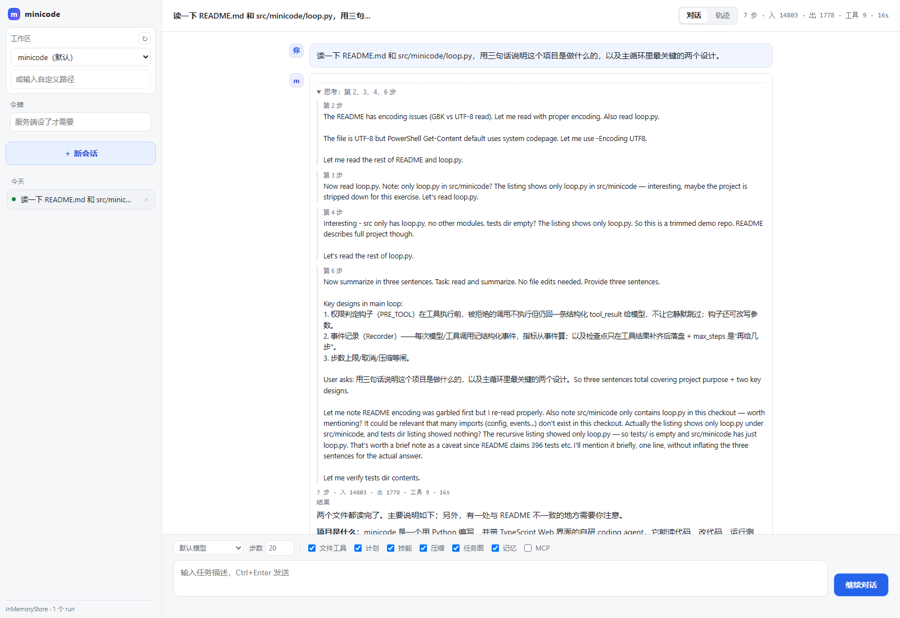
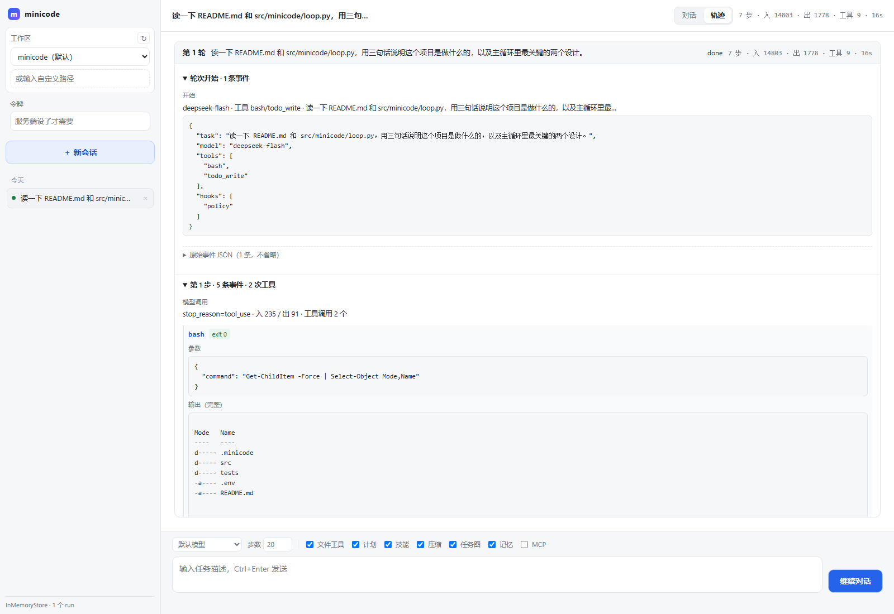
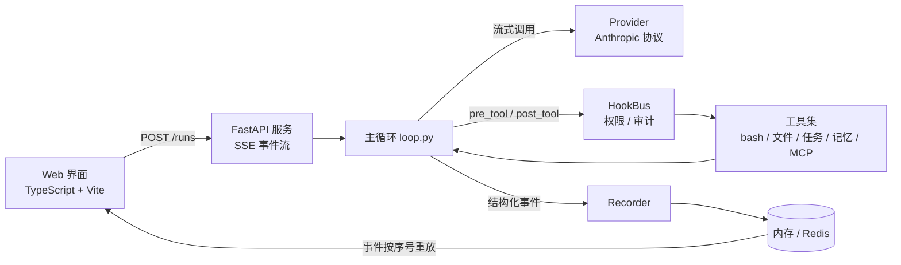

# minicode

[](https://github.com/Amumya/minicode/actions/workflows/ci.yml)
[](LICENSE)


一个自己写的 coding agent，Python + TypeScript。能读代码、改代码、跑测试，
但这些不是重点，重点是权限判定和评测这两层：每一步都有结构化事件，
命令执行前要过权限检查，任务算不算完成由隐藏测试判定，不靠模型自述。

现在有 396 条 Python 测试、69 条前端测试、60 项界面链路检查，CI 三个作业全绿。

> 仓库：`github.com/Amumya/minicode`　·　MIT　·　本地跑，默认只监听 127.0.0.1

## 演示

下面两张是实际跑起来的界面截图（同一轮任务）。

### 对话视图



左栏是工作区和按日期分组的历史会话；主区顶栏可以在「对话 / 轨迹」之间切换。
对话视图里每轮显示计划、思考（默认展开、按步骤标号）、用量和 Markdown 结果。

### 轨迹视图



轨迹视图按轮次和步骤展开完整原始记录：thinking 全文、模型调用用量、工具参数、
完整工具输出、meta，以及每一步可展开的原始事件 JSON。这里不做截断，方便核对
每一步到底发生了什么。

## 目录

- [为什么写这个](#为什么写这个)
- [现在能做什么](#现在能做什么)
- [架构](#架构)
- [量过的东西](#量过的东西)
- [怎么跑](#怎么跑)
- [怎么用](#怎么用)
- [目录结构](#目录结构)
- [已知限制](#已知限制)
- [评测与记录](#评测与记录)
- [参考](#参考)

## 为什么写这个

能跑起来的 coding agent 已经很多了。opencode 二十多万 star，codex 十二万，
gemini-cli 十万，OpenHands 八万多。再多一个"能读文件、能改代码、能跑测试"的
其实没什么意思。

我搜了一圈，发现有两块基本是空的：权限判定，能找到的开源实现里 star 最高的只有二十几个；
轨迹级评测，agentevals 七百多 star，去年 7 月之后就没再更新。

所以这个项目不打算拼功能面，想把这两块做扎实，每个结论尽量带上数字。

## 现在能做什么

### 主循环

调模型 → 执行工具 → 把结果和退出码带回去 → 收尾。bash 工具在 Windows 上底层走 PowerShell，
超时会连同子进程一起杀掉；输出是边读边攒的，超过上限就终止，不会先把内存吃满再截断。
文件读写工具（`read_file / write_file / edit_file`）默认不开，早期是拿它跟纯 bash 做对照实验用的。
一轮跑完可以接着聊下一轮，跑的过程中可以取消（当前这步结束后停），也可以派子代理去处理独立的小任务。
被 max_steps 截断时，检查点停在最后一次真实工具结果：续跑会接着执行，不会把"[skipped] 步数已用尽"喂给模型（那会让它直接总结收尾）。
模型返回的 thinking 块（带 signature）会原样保存并在下一轮 assistant 消息里回传，不会因为工具调用丢掉推理上下文；思考内容会按「第 N 步」展示在对话里：默认展开、每块末尾换行。

### 能力一览

| 能力 | 说明 | 开关 |
|---|---|---|
| bash | 执行命令，带超时、输出上限、进程树清理 | 默认可用 |
| 文件工具 | 读 / 写 / 改，路径限制在 workspace 内，改测试文件会被权限层拦 | CLI `--files`，界面"文件工具" |
| 任务清单 | `todo_write`，支持 `blockedBy` 依赖和环检测，同一时间只允许一条 in_progress | CLI `--plan`，界面"计划" |
| 技能 | `skills/*/SKILL.md`，目录进系统提示词，正文按需 `load_skill` | CLI `--skills`，界面"技能" |
| 任务图 | 建任务、认领、完成并报告解锁了谁；跨 run 持久化 | CLI `--tasks`，界面"任务图" |
| 长期记忆 | `remember / recall / forget`，JSONL 存储，按相关度注入 | CLI `--memory`，界面"记忆" |
| MCP | 外部 stdio server 的工具，默认关，白名单 + 运行时二次校验 | CLI `--mcp`，界面"MCP" |
| 子代理 | 独立上下文跑小任务，只把结论回给父代理 | CLI `--subagent` |
| 上下文压缩 | 大输出落盘、旧结果截断、剪最早整对，确定性行为 | CLI `--compact`，界面"压缩" |
| 取消 / 续跑 | `POST /runs/{id}/cancel`；检查点在工具结果补齐后落盘，`/resume` 接着跑 | 服务和界面 |

### 治理层

治理层的东西都挂在钩子上，主循环本身不为治理需求改。权限判定是分词之后按参数判，
不是子串黑名单，后面数字里能看到黑名单会被一层 shell 包装绕过。
上下文压缩不用 LLM 摘要，就是大输出落盘、旧结果截断、剪掉最早整对，行为是确定的。

### 界面与服务

界面是上面截图里的两视图布局：左栏工作区和历史会话，主区顶栏切换「对话 / 轨迹」。
轨迹视图按轮次/步骤展示完整原始记录，不折叠、不截断。会话在存储里就是一条
`parent_id` 链，`/conversations` 把它们串成会话，左栏按日期分组；
`/#/c/<会话 id>` 可以直接打开某个会话，加 `?view=trajectory` 直接进轨迹视图。
命令行有 `run / serve / dev / app / mcp`，`dev` 会顺手把 Redis 起来，`app` 是独立窗口，
渲染不出来会往普通窗口和系统浏览器降级。服务端用 SSE 推事件，支持断点续传。
默认没有鉴权、只监听 127.0.0.1，要的话可以用 `--token` 或 `MINICODE_TOKEN` 加一层令牌：
页面和静态资源不受影响，接口走 `Authorization: Bearer`，SSE 因为 EventSource 加不了请求头，
所以走 `?token=`。

### 记忆

长期记忆存在 `<workspace>/.minicode/memory.jsonl`，一行一条 JSON，同一句话只存一份，
单个工作区最多 200 条。注入系统提示词时按和当前任务的相关度挑，最多 8 条、1200 字符，
不会把全部记忆都塞进去。

### MCP

官方协议现在有两代：2026-07-28 那版没有 initialize 握手，每个请求自带 `_meta`；
2025-11-25 和更早的是握手式。我按"先发新版、被拒再回退旧版"实现，所以两种 server 都能接。
只做 stdio、只接 tools 能力。配置在 `<workspace>/.minicode/mcp.json`，默认关闭，
工具要用 `allow` 枚举白名单列出来，没列的不注册，运行时还会再查一次。
为什么这么严：外部工具的参数语义对我们是黑盒，没法像 shell 命令那样判定危不危险，只能把信任显式化。
`minicode mcp` 可以先体检配置，连上 server 列出模式、版本、工具和 schema 大小，不花模型钱。

### 评测

6 个沙箱任务，判定用隐藏测试，跑之前把测试文件设成只读，跑完再比对哈希，防作弊做了两条线。
`eval/verify_tasks.py` 可以几秒钟验证"起始代码下隐藏测试必须是挂的"，不需要调模型。

## 架构



一个 run 在 worker 线程里跑，事件同时写存储和唤醒 SSE；所以浏览器断线重连不会丢事件，
进程被杀之后检查点还在，能接着跑。

## 量过的东西

表里的 token 默认指输出 token。输入 token 随上下文变化很大，拿它当指标容易把结论带偏，
涉及总开销的地方我会单独写清楚。

| 项 | 结果 | 条件 |
|---|---|---|
| 危险命令拦截率 | 56.2% → 100% | 16 条危险命令，子串黑名单 vs 分词+参数判定 |
| 正常命令误报率 | 33.3% → 0% | 12 条正常命令，同上 |
| 沙箱任务通过率 | 96% → 100% | 6 任务 × 4 次（23/24 → 24/24），bash vs 加文件工具 |
| 沙箱花费（输出 token） | 7.1 步 / 1912 → 7.2 步 / 2336（+22%） | 同一组数据输入 token 3041→2246，合计 4953→4581（−7.5%）。所以"多 22%"只对输出成立，总开销其实略降 |
| 工具调用失败率 | 10.4% → 7.0% | 22/211 → 16/230 次工具调用 |
| 改多行结构 | 8.0 步 / 1431 → 7.5 步 / 893（−38%） | t4_config，改带中文和引号的字典 |
| 改一行代码 | 5.8 步 / 546 → 5.8 步 / 648 | t1_counter，加了文件工具反而更贵 |
| shell 写法不匹配 | 6 次 → 0 次 | 系统提示词里说明"底层是 PowerShell"，4 任务 × 2 次 |
| 解释器提示的效果 | 工具失败 6 → 3，耗时 29.0 → 26.0 秒 | 同一任务 3 次/组，只改"说不说用哪个 Python" |
| 技能目录开销 | 目录 92 字符 vs 正文 750 字符（12.3%） | 每轮少发约 658 字符（约 410 token，按 1.6 字符/token 粗估），正文按需加载 |
| 上下文压缩 | 输入 token 7597 → 4185（−45%），完成 2/3 → 3/3 | 读两个大文档，n=3/组；阈值调到 12000 那档一次都没触发，相当于没压 |
| 子代理隔离 | 父代理 2 步 / 526 token 拿到结论 | 子代理实际跑了 3 步 / 969 token，中间过程没进父上下文 |
| 断点续跑 | 中断在第 1 步 → 续跑后完成 | max_steps=1 故意中断，杀掉服务进程重启后 /resume |
| 进程重启不丢 | 结果和事件都还在 | Redis + AOF，杀掉 uvicorn 再起 |
| 改测试文件 | 权限层拦下 3 次，哈希比对抓到 1 次 | 防作弊两条线都真的触发过 |
| 权限用例集 | 70 条攻击/误杀用例 | 分词判定 + 嵌套 shell/包装器加固，全绿 |
| MCP 接入开销 | 启动+握手 105.6ms；2 个允许工具 schema 342 字符（约 213 token/轮）；单次调用 0.2ms | server 共 5 个工具，未允许的 3 个不注册也不占 token |

> 样本量说清楚：权限用例是我自己写的，不是从真实操作里抽的；沙箱每格 4 次重复
> （每个条件 24 次运行）；提示词实验每组 3 次。MCP 那行是单次的工程测量，用来看量级，
> 不当统计结论。

<details>
<summary>踩过的坑（点开）</summary>

- 隐藏测试曾经根本没被执行，文件名不匹配 pytest 的收集规则，所以更早那批"全过"的沙箱数字是错的，
  修好之后才重新量出 96%/100%。
- 工具失败率这个口径也错过一次：pytest 测试红本来就返回 1，那是 agent 要的信号，不能算失败，
  拆开之后实际的环境问题只占 9%。
- 加文件工具不是单向改进，通过率高 4 个点、输出 token 多 22%，但输入 token 少了、总开销略降，
  失败率也降了。
- 基准任务被污染过一次：agent 从工作区用 `..` 爬回项目，把起始代码改成了答案，后面一轮数据作废；
  现在工作区移出仓库，每次跑前后比对源目录指纹。
- 权限层也被包装绕过过，`bash -c "rm -rf /"`、`powershell -Command "Remove-Item ..."`、
  `rm -rf $HOME` 这些在加固前全部放行，现在改成了嵌套命令递归判定。
- 一组反例：把"测试用 .venv 里的 python"记进记忆再问同一个问题，开/关记忆都是第一步就做对，
  因为这条信息仓库里本来就能看到。记忆只在"仓库里查不到的信息"上才有用。

</details>

原始记录都在 [eval/runs/](eval/runs/) 里，能自己复跑：

```powershell
# 权限对照，不需要 key，19 毫秒
.venv\Scripts\python.exe eval\check_permission.py

# 任务自洽检查（不跑模型）：起始代码下隐藏测试必须是挂的
.venv\Scripts\python.exe eval\verify_tasks.py

# 沙箱消融，要 key，两组各 24 次
.venv\Scripts\python.exe eval\sandbox_run.py --condition bash  --repeat 4 --max-steps 12
.venv\Scripts\python.exe eval\sandbox_run.py --condition files --repeat 4 --max-steps 12
.venv\Scripts\python.exe eval\compare_conditions.py

# 提示词与压缩的对照实验
.venv\Scripts\python.exe eval\ab_python_hint.py --repeat 3
.venv\Scripts\python.exe eval\ab_compact.py --repeat 2
.venv\Scripts\python.exe eval\measure_prompts.py
```

## 怎么跑

```powershell
python -m venv .venv
.venv\Scripts\python.exe -m pip install -e ".[dev]"
.venv\Scripts\python.exe -m pytest
```

网络不稳的时候 PyPI 会时通时不通，装不上可以先配个国内镜像，或者跳过 pytest 直接跑自检脚本：

```powershell
$env:PYTHONPATH = "src"
.venv\Scripts\python.exe tests\run_tests.py
```

前端构建产物（`src/minicode/service/web/`）是提交进仓库的，clone 下来不装 npm 也能直接看界面。
要改前端源码：

```powershell
npm ci --prefix web
npm --prefix web run build     # 产物直接吐到 src/minicode/service/web/
npm --prefix web test          # 纯逻辑和接线检查，不需要浏览器
```

### 桌面窗口（可选）

想要独立原生窗口（PySide6 + QWebEngineView）：

```powershell
pip install -e ".[serve,desktop]"
minicode app --mode gui
```

`--mode auto`（默认）优先开桌面窗口，起不来自动退回浏览器窗口；`--mode app` / `window`
强制用浏览器窗口。桌面依赖（PySide6）约 350MB，只跑命令行不需要装。

### 测试与 CI

| 部分 | 数量 | 命令 |
|---|---|---|
| Python 测试 | 396 条 | `pytest`（不需要 API key） |
| 前端纯逻辑测试 | 69 条 | `npm --prefix web test` |
| 界面链路检查 | 60 项 | `node web/uicheck.mjs` |
| CI | 3 个作业（Python 3.11 / 3.12 / 前端） | `.github/workflows/ci.yml` |

## 怎么用

最省事的是：

```powershell
minicode dev --build --open
```

### 单纯跑任务

```powershell
minicode run "数一下 src/minicode 下有几个 py 文件"
minicode run --memory "记住：这个仓库测试用 .venv 里的 python"
minicode run --mcp "用 MCP 的 add 工具算 7+35"
```

### 起服务看事件流

```powershell
# 窗口 1
minicode serve --port 8765

# 窗口 2
curl.exe -s -X POST http://127.0.0.1:8765/runs -H "Content-Type: application/json" `
  -d '{\"task\":\"数一下 src 下有几个 py 文件\"}'

curl.exe -sN http://127.0.0.1:8765/runs/<上一步返回的 id>/events
```

事件顺序大概是 `start → model_call → tool_call → assistant_delta → finish → end`，
每条 data 都是 JSON，`assistant_delta` 是流式输出的文字增量。

浏览器打开 `http://127.0.0.1:8765/` 就是界面。文件工具、计划、技能、压缩、任务图、记忆
默认都开着，步数默认 20，最多 50。会话可以直接用链接分享。

### 加访问令牌

服务和页面默认没有鉴权，只监听 127.0.0.1。要加令牌：

```powershell
minicode serve --port 8765 --token 换成你的令牌
```

开了之后页面和静态资源照常，浏览器界面在左栏"令牌"里填同一个值（存 localStorage）；
curl 加 `-H "Authorization: Bearer <令牌>"`，SSE 加 `?token=<令牌>`。`/healthz` 始终免鉴权。

### 接 Redis 持久化

`minicode app` / `minicode serve` / `minicode dev` 默认会启动仓库里的便携 Redis，
历史跨重启保存；如果机器上没有便携 Redis，会退化成内存存储（控制台会写明）。
显式用内存：加 `--no-redis`。接自己的 Redis：

```powershell
$env:MINICODE_REDIS_URL = "redis://127.0.0.1:6380/0"
minicode serve --port 8765
```

接了 Redis 之后进程被杀再起来，run 和历史事件都还在，跑了一半的任务可以接着跑：

```powershell
curl.exe -s -X POST http://127.0.0.1:8765/runs/<id>/resume -H "Content-Type: application/json" -d "{\"max_steps\":8}"
```

store 里如果混进测试数据（历史里出现 x、回滚这种，点开报模型不存在），可以先看看要删什么再删：

```powershell
$env:MINICODE_REDIS_URL = "redis://127.0.0.1:6380/0"
.venv\Scripts\python.exe tools\clean_store.py --dry-run
.venv\Scripts\python.exe tools\clean_store.py
```

也可以单条删：`DELETE /runs/{id}`。

### 接 MCP

配置长这样（示例在 [docs/mcp.example.json](docs/mcp.example.json)），三层限制缺一不可：
`enabled` 才会连、`allow` 里的工具才注册、运行时再查一次白名单。

```json
{
  "servers": [
    {
      "name": "filesystem",
      "command": "npx",
      "args": ["-y", "@modelcontextprotocol/server-filesystem", "D:\\work\\demo"],
      "enabled": true,
      "allow": ["read_file", "list_directory"],
      "timeout": 30
    }
  ]
}
```

配置里的 `command` 等于允许它在你机器上执行任意代码，这是 MCP 本身的风险，不是实现问题，
所以默认关闭加白名单，`minicode mcp` 会先把完整命令行打出来让你确认。

## 目录结构

```text
src/minicode/
  loop.py          主循环：模型调用 → 工具执行 → 结果回填 → 收尾
  provider.py      模型客户端（Anthropic 协议，流式输出）
  prompts.py       系统提示词拼装（环境事实 / 计划 / 任务图 / 记忆 / MCP）
  policy.py        权限判定：分词 + 参数级规则 + 嵌套 shell 递归
  hooks.py         钩子总线（pre_tool / post_tool），权限和审计都挂这里
  events.py        结构化事件记录，指标从事件算
  compact.py       上下文压缩（大输出落盘、旧结果截断、剪最早整对）
  memory.py        跨 run 长期记忆（JSONL + 相关度挑选）
  mcp.py           MCP 客户端（2026-07-28 现代版 + 旧版回退，stdio）
  tasks.py         任务图（依赖、认领、解锁，跨 run 持久化）
  subagent.py      子代理（上下文隔离）
  skills.py        技能目录与按需加载
  cli.py / dev.py / app_shell.py   命令行、一键开发环境、桌面窗口（PySide6 / 浏览器降级）
  tools/           bash / 文件 / 清单 / 任务图 / 技能 / 记忆 / MCP 工具
  service/         FastAPI 服务（app.py）、存储（store.py：内存 + Redis）
web/               前端（TypeScript + Vite，无框架，产物已提交到 service/web/）
eval/              沙箱任务集、判定器、对照实验脚本和原始记录（eval/runs/）
tests/             396 条 Python 测试，外加一个 fixture MCP server
docs/              决策台账、MCP 配置示例、界面截图
```

## 已知限制

- MCP 只做了 stdio 和 tools，HTTP 传输、resources/prompts/sampling 都没做；server 要求补输入（MRTR）时直接报错。
- 不做多 server 并行和自动重启，失败就让它失败。
- 服务没有完整鉴权方案，只承诺本机可用，不要往公网开。
- 单机自用，多进程同时写同一个 workspace 的锁也没做。
- 桌面窗口是可选依赖（PySide6，约 350MB），Qt 后端默认关掉 Chromium 沙箱（窗口只加载本机页面）。

还有一个功能做过又撤掉了：在文件管理器里打开工作区目录。排查到本机进程跑在受限令牌里，
Windows 拒绝 ShellExecute，spawn explorer 会崩，与其留一个看着成功实际没做事的实现，不如去掉。

## 评测与记录

每次取舍的原因和当时的实测数据记在 [docs/取舍与证据.md](docs/取舍与证据.md)，一共 68 条。
MCP 配置示例在 [docs/mcp.example.json](docs/mcp.example.json)。README 里的数字都能在那份台账里找到出处。

评测目录的说明见 [eval/README.md](eval/README.md)：任务集、判定流程、防作弊、脚本参数、记录字段、
口径都在里面。

## 参考

- learn-claude-code（`github.com/shareAI-lab/learn-claude-code`），s01 到 s17 我照着学了一遍
- mini-swe-agent（`github.com/SWE-agent/mini-swe-agent`），最小闭环的实现

代码是自己写的，没有把这两个项目的源码复制进来。
