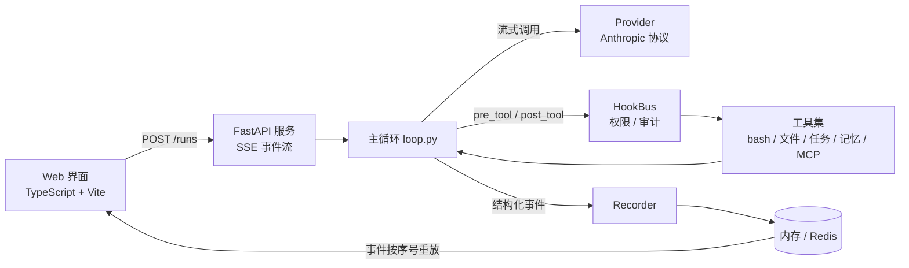

# minicode

[](https://github.com/Amumya/minicode/actions/workflows/ci.yml)
[](LICENSE)


minicode 是一个面向工具调用型 coding agent 的工程化实现，使用 Python 与 TypeScript。
项目重点不在扩展工具数量，而在两处工程治理：

1. **执行治理**：工具调用执行前经过统一权限判定，执行前后产生结构化审计事件；
2. **效果评估**：任务是否完成由隐藏测试判定，不以模型自述为依据，并保留可复现的实验记录。

当前包含 403 条 Python 测试、74 条前端测试和 77 项界面链路检查，CI 三个作业全部通过。

> 仓库：`github.com/Amumya/minicode` · MIT · 本地运行，默认仅监听 `127.0.0.1`

## 演示

以下为实际运行界面截图，来自同一轮任务。

### 对话视图


界面采用左侧工作区/历史会话、右侧主区的双栏布局，主区顶部可在「对话 / 轨迹」之间切换。
对话视图按轮次展示计划、用量和 Markdown 结果；任务因步数上限中断或取消时，会明确标记
“这不是最终结果”，并保留中断前输出；若任务恰好在上限处结束，则提示可继续执行。
运行期间，会话末尾显示当前步骤、正在执行的工具和已用时间，顶部徽章同步状态。

### 轨迹视图


轨迹视图以事件日志形式记录一次 run 的完整执行过程，包括系统提示、模型调用、工具参数与
完整输出、上下文压缩、权限拒绝和结束状态。事件按发生顺序追加；每条事件均可展开查看原始
JSON。工具参数、输出和元数据默认折叠，展开时再渲染；视图支持尾部自动跟随，向上滚动后
暂停跟随。

## 目录

- [背景与目标](#背景与目标)
- [功能概览](#功能概览)
- [架构](#架构)
- [实验与测量](#实验与测量)
- [快速开始](#快速开始)
- [使用方式](#使用方式)
- [目录结构](#目录结构)
- [已知限制](#已知限制)
- [评测与记录](#评测与记录)
- [参考](#参考)

## 背景与目标

通用 coding agent 已有较多成熟实现。本项目不以功能覆盖为目标，而是针对两个容易被弱化的
工程问题做可验证的实现：

1. **权限判定不能只依赖子串黑名单**。需要解析命令结构、参数语义和嵌套调用；
2. **任务完成度不能只依赖模型自述**。需要隐藏测试、可复现实验和可审计的事件记录。

因此项目中的关键结论均尽量附带实验条件与数据来源，相关记录保存在 `eval/runs/` 与
`docs/取舍与证据.md`。

## 功能概览

### 主循环

一次 run 的基本流程为：调用模型 → 执行工具 → 回填工具结果 → 判断是否结束。

- 主循环支持流式输出、取消、断点续跑、多轮 followup 与上下文压缩；
- 工具调用前统一经过 `PRE_TOOL` 钩子，执行后经过 `POST_TOOL` 钩子；
- `max_steps` 截断时，检查点停留在最后一次真实工具结果，续跑从该状态继续，避免将伪造的
  截断结果写入上下文；
- 工具执行具备超时、输出上限与进程树清理机制；
- 对话、工具调用、权限拒绝、压缩和结束状态均写入结构化事件。

### 能力一览

| 能力 | 说明 | 开关 |
|---|---|---|
| bash | 执行命令，支持超时、输出上限与进程树清理 | 默认启用 |
| 文件工具 | 读 / 写 / 改，路径限制在工作区内，测试文件受权限层保护 | CLI `--files`，界面“文件工具” |
| 任务清单 | `todo_write`，支持 `blockedBy` 依赖与环检测 | CLI `--plan`，界面“计划” |
| 技能 | `skills/*/SKILL.md`，目录进入系统提示词，正文按需加载 | CLI `--skills`，界面“技能” |
| 任务图 | 创建、认领、完成并报告解锁关系，跨 run 持久化 | CLI `--tasks`，界面“任务图” |
| 长期记忆 | `remember / recall / forget`，JSONL 存储，按相关度注入 | CLI `--memory`，界面“记忆” |
| MCP | 外部 stdio server 工具，默认关闭，白名单与运行时二次校验 | CLI `--mcp`，界面“MCP” |
| 子代理 | 独立上下文执行子任务，仅返回结论 | CLI `--subagent` |
| 上下文压缩 | 大输出落盘、旧结果截断、消息整对裁剪，行为确定 | CLI `--compact`，界面“压缩” |
| 取消 / 续跑 | 取消接口与检查点续跑，检查点在工具结果补齐后写入 | 服务端与界面 |

### 治理层

治理能力通过钩子机制接入，主循环本身不依赖具体治理策略：

- 权限判定采用分词与参数级规则，对嵌套 shell、包装器和路径越界递归分析；
- 上下文压缩不使用模型摘要，而是确定性的落盘、截断与整对裁剪；
- 权限拒绝、钩子异常、压缩统计等均记录为结构化事件，便于审计与指标计算。

### 界面与服务

- 前端为 TypeScript + Vite 实现，无框架依赖，构建产物提交在 `src/minicode/service/web/`；
- 桌面窗口使用 PySide6 + QWebEngineView，属于可选依赖；浏览器访问是默认入口；
- 服务使用 FastAPI，通过 SSE 推送事件，支持 `Last-Event-ID` 断点续传；
- 会话由 `parent_id` 链组织，`GET /conversations` 聚合，界面按日期分组；
- `/#/c/<会话 id>` 可直接打开会话，`?view=trajectory` 可直接进入轨迹视图；
- 命令行提供 `run / serve / dev / app / mcp` 子命令；
- 静态入口 `index.html` 返回 `Cache-Control: no-store`，桌面窗口使用缓存禁用与版本参数，
  避免客户端加载旧构建产物。

### 记忆

长期记忆保存在 `<workspace>/.minicode/memory.jsonl`，每行一条 JSON，同一内容去重，
单工作区上限 200 条。注入系统提示词时按与当前任务的相关度选择，最多 8 条、1200 字符。

### MCP

支持两代 MCP 协议：`2026-07-28` 版本无 initialize 握手，每个请求携带 `_meta`；
`2025-11-25` 及更早版本使用握手式流程。客户端优先尝试新版本，被拒绝后回退旧版本。

当前仅实现 stdio 传输与 tools 能力。配置位于 `<workspace>/.minicode/mcp.json`，默认关闭；
工具必须通过 `allow` 枚举白名单注册，运行时再次校验。

### 评测

评测任务集包含 6 个沙箱任务，使用隐藏测试判定完成度。评测前将测试文件设为只读，
评测后进行哈希比对，防作弊分为权限拦截与结果校验两条线。

`eval/verify_tasks.py` 可在不调用模型的情况下验证任务自洽性：在起始代码上，
隐藏测试必须失败，避免任务本身已包含答案。

## 架构



一次 run 在独立 worker 线程中执行。事件同时写入存储并唤醒 SSE 推送，因此客户端断线重连
不会丢失事件；进程重启后，检查点与事件仍可用于恢复执行。

## 实验与测量

表中的 token 默认指输出 token；输入 token 受上下文影响较大，涉及总成本时单独说明。

| 项目 | 结果 | 实验条件 |
|---|---|---|
| 危险命令拦截率 | 56.2% → 100% | 16 条危险命令，子串黑名单与结构化解判定对比 |
| 正常命令误报率 | 33.3% → 0% | 12 条正常命令，同上 |
| 沙箱任务通过率 | 96% → 100% | 6 任务 × 4 次（23/24 → 24/24），bash 与增加文件工具对比 |
| 沙箱输出 token | 7.1 步 / 1912 → 7.2 步 / 2336（+22%） | 输入 token 3041 → 2246，合计 4953 → 4581（−7.5%） |
| 工具调用失败率 | 10.4% → 7.0% | 22/211 → 16/230 次工具调用 |
| 多行结构修改 | 8.0 步 / 1431 → 7.5 步 / 893（−38%） | t4_config，修改含中文与引号的字典 |
| 单行代码修改 | 5.8 步 / 546 → 5.8 步 / 648 | t1_counter，增加文件工具后成本上升 |
| shell 写法不匹配 | 6 次 → 0 次 | 系统提示词说明底层为 PowerShell，4 任务 × 2 次 |
| 解释器提示 | 工具失败 6 → 3，耗时 29.0 → 26.0 秒 | 同一任务每组 3 次，仅调整是否说明 Python 解释器 |
| 技能目录开销 | 目录 92 字符，正文 750 字符（12.3%） | 正文按需加载，每轮减少约 658 字符 |
| 上下文压缩 | 输入 token 7597 → 4185（−45%），完成 2/3 → 3/3 | 读取两个大文档，每组 3 次 |
| 子代理隔离 | 父代理 2 步 / 526 token 获得结论 | 子代理实际执行 3 步 / 969 token，中间过程不进入父上下文 |
| 断点续跑 | 第 1 步中断后续跑完成 | `max_steps=1` 中断，重启服务后调用 `/resume` |
| 进程重启不丢 | 结果与事件保留 | Redis + AOF，重启 uvicorn 后验证 |
| 测试文件修改 | 权限层拦截 3 次，哈希比对捕获 1 次 | 防作弊两条线均实际触发 |
| 权限用例集 | 70 条攻击/误判用例 | 分词判定与嵌套 shell 加固后全部通过 |
| MCP 接入开销 | 启动+握手 105.6ms；2 个允许工具 schema 342 字符（约 213 token/轮）；单次调用 0.2ms | server 共 5 个工具，未允许的 3 个不注册 |

> 样本量说明：权限用例由项目自建，并非来自真实操作抽样；沙箱每条件 24 次运行；
> 提示词实验每组 3 次；MCP 数据为单次工程测量，仅用于判断量级。

### 验证过程中修正的问题

<details>
<summary>展开查看</summary>

- 隐藏测试曾未被 pytest 收集，导致早期“全部通过”的沙箱数据无效；修正收集规则后重新测量，
  得到 96%/100%。
- 工具失败率口径曾有误：pytest 测试返回非零退出码本身是 agent 需要处理的信号，不应计为
  工具失败；拆分环境问题与实际失败后重新统计。
- 文件工具并非单向收益：通过率提升 4 个百分点，输出 token 增加 22%，但输入 token 下降，
  总成本略降，失败率下降。
- 基准任务曾被污染：agent 通过路径穿越修改了起始代码，导致一轮数据作废。当前工作区已移出
  仓库，并在运行前后比对源目录指纹。
- 权限层曾被包装器绕过：`bash -c "rm -rf /"`、`powershell -Command "Remove-Item ..."` 等
  在加固前未拦截；当前对嵌套命令递归判定。
- 记忆存在反例：将“测试使用 `.venv` 中的 Python”写入记忆后，开启或关闭记忆均能在第一步
  正确执行，因为该信息可从仓库直接获得。记忆只对仓库外信息产生增量价值。

</details>

原始记录位于 [eval/runs/](eval/runs/)，可按以下命令复现：

```powershell
# 权限对照，不调用模型，约 19 毫秒
.venv\Scripts\python.exe eval\check_permission.py

# 任务自洽检查，不调用模型
.venv\Scripts\python.exe eval\verify_tasks.py

# 沙箱消融实验，需要 API key，两个条件各 24 次
.venv\Scripts\python.exe eval\sandbox_run.py --condition bash  --repeat 4 --max-steps 12
.venv\Scripts\python.exe eval\sandbox_run.py --condition files --repeat 4 --max-steps 12
.venv\Scripts\python.exe eval\compare_conditions.py

# 提示词与压缩对照实验
.venv\Scripts\python.exe eval\ab_python_hint.py --repeat 3
.venv\Scripts\python.exe eval\ab_compact.py --repeat 2
.venv\Scripts\python.exe eval\measure_prompts.py
```

### 并发与多会话压测

服务层使用假 provider 进行压测，不调用真实模型。CI 中的 `tests/test_concurrency.py`
覆盖并发 run 隔离、并发 SSE、取消、并发 followup 与 RedisStore 并发写入；网络层使用
`tools/loadtest.py` 测量：

| 场景 | runs / 并发 | store | 工具 | 建 run p50 / p95 | 总耗时 | error |
|---|---:|---|---|---:|---:|---:|
| 服务层开销 | 80 / 40 | InMemory | todo_write | 228 / 277 ms | 2.18 s | 0 |
| 服务层开销 | 200 / 100 | InMemory | todo_write | 434 / 519 ms | 5.39 s | 0 |
| 真实工具开销 | 80 / 40 | InMemory | bash | 906 / 1640 ms | 16.6 s | 0 |
| 持久化 store | 100 / 50 | Redis | todo_write | 438 / 509 ms | 4.11 s | 0 |

200 并发时，200 条 SSE 流均只收到自身事件，200 个 followup 均正确挂回对应会话，错误数为 0。
bash 场景耗时主要来自 PowerShell 子进程启动，而非循环或存储层。

复现命令：

```powershell
.venv\Scripts\python.exe tools\loadtest.py --runs 200 --concurrency 100 --tool todo_write
```

详细方法与局限见 [docs/并发压测.md](docs/并发压测.md)。

## 快速开始

```powershell
python -m venv .venv
.venv\Scripts\python.exe -m pip install -e ".[dev]"
.venv\Scripts\python.exe -m pytest
```

网络不稳定时可配置国内 PyPI 镜像。若仅需运行自检脚本：

```powershell
$env:PYTHONPATH = "src"
.venv\Scripts\python.exe tests\run_tests.py
```

前端构建产物已提交在 `src/minicode/service/web/`，克隆仓库后不安装 Node.js 即可查看界面。
修改前端源码时：

```powershell
npm ci --prefix web
npm --prefix web run build
npm --prefix web test
```

### 桌面窗口（可选）

```powershell
pip install -e ".[serve,desktop]"
minicode app --mode gui
```

`--mode auto`（默认）优先启动桌面窗口，失败时回退浏览器窗口；`--mode app` / `window`
强制使用浏览器窗口。PySide6 约 350MB，仅运行命令行时无需安装。

### 测试与 CI

| 部分 | 数量 | 命令 |
|---|---|---|
| Python 测试 | 403 条 | `pytest`（无需 API key） |
| 前端逻辑测试 | 74 条 | `npm --prefix web test` |
| 界面链路检查 | 77 项 | `node web/uicheck.mjs` |
| CI | 3 个作业：Python 3.11 / 3.12 / 前端 | `.github/workflows/ci.yml` |

运行环境：Python 3.11+，本地开发使用 3.12；Node.js 仅用于前端开发与构建。

## 使用方式

### 命令行

```powershell
minicode run "统计 src/minicode 下的 Python 文件数量"
minicode run --memory "记住：本仓库测试使用 .venv 中的 Python"
minicode run --mcp "使用 MCP 的 add 工具计算 7+35"
```

### HTTP 与事件流

```powershell
# 终端 1
minicode serve --port 8765

# 终端 2
curl.exe -s -X POST http://127.0.0.1:8765/runs -H "Content-Type: application/json" `
  -d '{"task":"统计 src 下的 Python 文件数量"}'

curl.exe -sN http://127.0.0.1:8765/runs/<run_id>/events
```

事件顺序通常为 `start → model_call → tool_call → assistant_delta → finish → end`，
每条 `data` 为 JSON，`assistant_delta` 为流式文本增量。

浏览器访问 `http://127.0.0.1:8765/` 即为界面。文件工具、计划、技能、压缩、任务图和
记忆默认启用；前端固定使用默认 20 步，不提供步数修改入口。CLI 与 HTTP API 仍可通过
`max_steps` 覆盖，服务端上限 50。

### 访问令牌

服务默认无鉴权，仅监听 `127.0.0.1`。启用令牌：

```powershell
minicode serve --port 8765 --token <token>
```

启用后，页面与静态资源仍可访问；浏览器界面在左栏填写令牌并保存到 localStorage。
curl 使用 `Authorization: Bearer <token>`，SSE 使用 `?token=<token>`；`/healthz` 始终免鉴权。

### Redis 持久化

`minicode app` / `serve` / `dev` 默认启动仓库内的便携 Redis，历史记录可跨重启保留；
若环境中没有便携 Redis，则退化为内存存储并在控制台提示。显式使用内存可加 `--no-redis`。

连接外部 Redis：

```powershell
$env:MINICODE_REDIS_URL = "redis://127.0.0.1:6380/0"
minicode serve --port 8765
```

接入 Redis 后，进程重启仍保留 run 与历史事件，可继续执行未完成任务：

```powershell
curl.exe -s -X POST http://127.0.0.1:8765/runs/<id>/resume -H "Content-Type: application/json" -d "{\"max_steps\":8}"
```

如存储中存在测试数据，可先预览再清理：

```powershell
$env:MINICODE_REDIS_URL = "redis://127.0.0.1:6380/0"
.venv\Scripts\python.exe tools\clean_store.py --dry-run
.venv\Scripts\python.exe tools\clean_store.py
```

单条删除使用 `DELETE /runs/{id}`。

### MCP

配置示例见 [docs/mcp.example.json](docs/mcp.example.json)。启用需要同时满足三层限制：
`enabled` 为 true、工具在 `allow` 白名单中、运行时二次校验通过。

```json
{
  "servers": [
    {
      "name": "filesystem",
      "command": "npx",
      "args": ["-y", "@modelcontextprotocol/server-filesystem", "D:\\work\\demo"],
      "enabled": true,
      "allow": ["read_file", "list_directory"],
      "timeout": 30
    }
  ]
}
```

`command` 字段允许 MCP server 在本机执行命令，属于协议本身的信任边界。因此项目默认关闭
MCP，并要求显式白名单；`minicode mcp` 会在连接前打印完整命令供确认。

## 目录结构

```text
src/minicode/
  loop.py          主循环：模型调用 → 工具执行 → 结果回填 → 收尾
  provider.py      模型客户端（Anthropic 协议，流式输出）
  prompts.py       系统提示词拼装（环境事实 / 计划 / 任务图 / 记忆 / MCP）
  policy.py        权限判定：分词 + 参数级规则 + 嵌套 shell 递归
  hooks.py         钩子总线（pre_tool / post_tool），权限与审计接入点
  events.py        结构化事件记录，指标从事件计算
  compact.py       上下文压缩（大输出落盘、旧结果截断、消息整对裁剪）
  memory.py        跨 run 长期记忆（JSONL + 相关度选择）
  mcp.py           MCP 客户端（双协议版本，stdio）
  tasks.py         任务图（依赖、认领、解锁，跨 run 持久化）
  subagent.py      子代理（上下文隔离）
  skills.py        技能目录与按需加载
  cli.py / dev.py / app_shell.py   命令行、开发环境、桌面窗口
  tools/           bash / 文件 / 清单 / 任务图 / 技能 / 记忆 / MCP 工具
  service/         FastAPI 服务与存储（内存 + Redis）
web/               前端（TypeScript + Vite，构建产物提交至 service/web/）
eval/              沙箱任务集、判定器、对照实验脚本与原始记录
tests/             403 条 Python 测试与 fixture MCP server
docs/              决策记录、MCP 配置示例、界面截图
tools/             开发辅助脚本（store 清理、并发压测）
```

## 已知限制

- MCP 仅实现 stdio 与 tools；HTTP 传输、resources/prompts/sampling 与 MRTR 尚未实现。
- 不支持多 MCP server 并行执行与自动重启。
- 服务端没有完整鉴权体系，仅适用于本机或受信网络，不应直接暴露到公网。
- 单机多进程同时写同一工作区未加锁。
- 桌面窗口依赖 PySide6（约 350MB），且 QtWebEngine 在部分环境需要额外启动参数。

## 评测与记录

决策记录与实验数据见 [docs/取舍与证据.md](docs/取舍与证据.md)，共 79 条。
MCP 配置示例见 [docs/mcp.example.json](docs/mcp.example.json)。
README 中的数字均可在决策记录或 `eval/runs/` 中找到出处。

评测目录说明见 [eval/README.md](eval/README.md)：任务集、判定流程、防作弊、脚本参数、
记录字段与统计口径。

## 参考

- learn-claude-code：`github.com/shareAI-lab/learn-claude-code`
- mini-swe-agent：`github.com/SWE-agent/mini-swe-agent`

本项目代码为独立实现，未复制上述项目源码。
